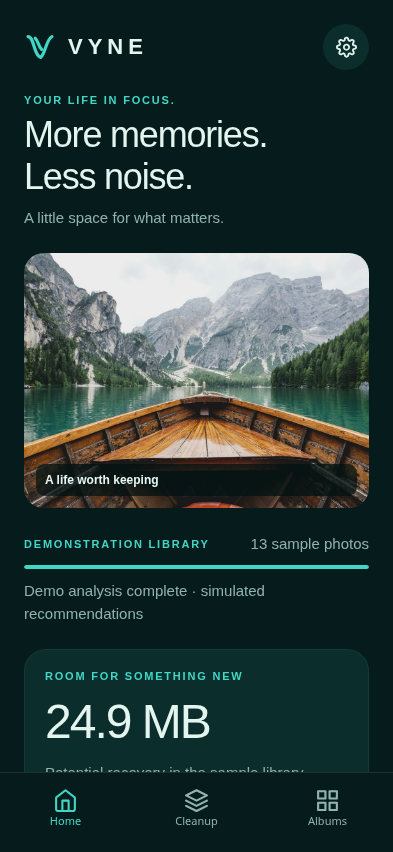
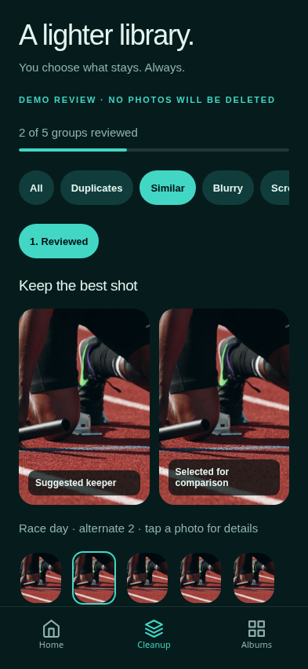
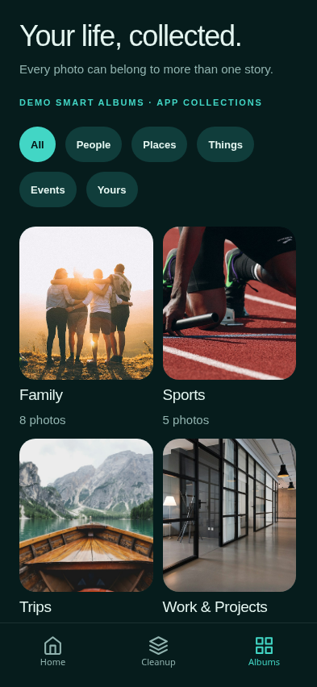

# M1 verification and iPhone runbook

## Verified in Codex Cloud — 2026-10-17

Environment: Linux x86_64, Node 24.19.0, npm 11.9.0. No Xcode, `xcrun`, iOS Simulator or physical iPhone is available here.

| Check | Result |
| --- | --- |
| Dependency install and lockfile | Installed; committed app lockfile |
| `npx expo install --check` | Pass: SDK 58 dependency versions compatible |
| `npm run typecheck` | Pass: strict TypeScript |
| `npm run lint` | Pass |
| `npm test` | 22 passing domain/SQLite tests (including snapshot recovery regressions) |
| `npx expo export --platform ios` | Pass: Hermes JS bundle and bundled assets; **not a native build** |
| `npx expo export --platform web` | Pass: JS/WASM/assets |
| `npx expo prebuild --platform ios --no-install` | Pass: generated native project configuration; CocoaPods/Xcode compilation not run |
| Browser interaction suite | Pass: all seven screens, navigation, side-by-side comparison, cancel/confirm review, saved review after reload, keeper/memory protection, custom album and membership persistence, full-screen viewer, learning reset, storage history, settings persistence and complete demo reset; no page runtime errors |
| Browser visual inspection | Actual Chromium captures at 393 × 852; Home, Cleanup and Albums inspected; tab spacing corrected |
| `npx expo-doctor` | 18/20 checks pass. Two online checks blocked: Expo config-schema API connection refused (`34.110.201.56:443`) and React Native Directory metadata server response failure. Local config evaluation, dependency compatibility, prebuild and exports succeed. Re-run on Mac/network with Expo API access. |
| `npm audit --omit=dev` | 26 reported transitive advisories: 19 high, 7 moderate. Direct advisory roots are `braces`, `node-forge`, and `uuid` in Expo/Metro/config tooling dependency trees. No safe compatible fix was offered; npm suggests downgrading to Expo 44 with `--force`, which is incompatible with this app. Do not apply that downgrade. Reassess upstream fixes before distribution. |
| Native iPhone / iOS Simulator | **Not run. M1 device acceptance remains open.** |

Tests exercise review revision semantics, protected memory exclusions, unique storage totals, overlapping Keep protection, many-to-many corrections, Skip neutrality, personalized explanations, ignored/paused learning, learning-reset isolation, parameterized SQLite round trips, and unknown schema rejection.

Browser SQLite uses Expo's WASM/OPFS implementation; iPhone uses native SQLite. Reload persistence in Chromium is evidence for UI/store wiring, not proof of native lifecycle behavior. The Swift contract is uncompiled design source, not an implemented bridge.

## Exact Mac setup and simulator launch

1. Install a supported Xcode version for Expo SDK 58 / React Native 0.88, launch Xcode once, accept its license, and install an iOS Simulator runtime in Xcode Settings → Components. Install Node 24+ and CocoaPods using your normal Mac development setup.
2. Select the full Xcode developer directory if necessary:

   ```sh
   sudo xcode-select --switch /Applications/Xcode.app/Contents/Developer
   ```

3. Check out the implementation branch and install locked dependencies:

   ```sh
   git clone https://github.com/nrsandoval1231-oss/vyne.git
   cd vyne
   git fetch origin
   git switch --track origin/feat/vyne-m1
   cd apps/ios
   npm ci
   npx expo install --check
   npx expo-doctor
   npm run typecheck
   npm run lint
   npm test
   npx expo run:ios
   ```

   Expo generates `apps/ios/ios`, installs native dependencies and builds the development app. Generated native projects are ignored. The committed `expo-dev-client` supports the development-build path. Expo Go is not the intended native integration path.

4. Once installed, subsequent JS-only sessions can use:

   ```sh
   npx expo start --dev-client
   ```

No environment variables, backend, API keys or user photo permissions are required for M1.

## Exact physical iPhone next steps

1. Connect an iPhone to the Mac, unlock it, trust the Mac and enable Settings → Privacy & Security → Developer Mode if requested. Add your Apple account in Xcode Settings → Accounts.
2. From `apps/ios`, run:

   ```sh
   npx expo run:ios --device
   ```

3. Select the connected iPhone. If signing needs configuration, open the generated `ios/VYNE.xcworkspace`, select the VYNE target → Signing & Capabilities, choose your development team, enable automatic signing, and use a unique bundle identifier if `com.vyne.app` conflicts. This is local development signing; do not commit credentials or provisioning profiles. Re-run the command or build from Xcode.
4. Keep Mac and iPhone on the same reachable network for Metro (or use a suitable local USB development setup). Open the installed VYNE development app.
5. Verify the following manually and record iPhone/iOS/Xcode versions and results in the PR:
   - Home/Cleanup/Albums tabs, back-swipe navigation, full-screen pinch zoom, all secondary screens.
   - Keep/Skip/cancel/confirm review, five-photo similar group, protected blurry memory, overlapping screenshots.
   - Force-quit and relaunch: decisions, custom albums, corrected memberships and settings remain.
   - Learning hints update; paused decisions do not become new signals on resume; Reset Learning preserves review/album state; full demo reset restores fixtures.
   - Airplane mode after the app and bundle load: all demo images remain available and actions persist. A Metro development session itself needs connectivity for bundle loading; an offline packaged release build is a separate native check.
   - Large accessibility text, VoiceOver focus/labels, safe areas, reduced motion, small-screen layouts and contrast.
   - No Apple Photos permission prompt, original modification, deletion or image upload occurs.
6. Do not mark device acceptance complete until these checks have actually run. M2 requires additional real PhotoKit permission/reconciliation/deletion tests.

## Reproduce browser checks

```sh
cd apps/ios
npm ci
npx playwright install chromium
npm run web -- --port 8081
# In a second terminal, from apps/ios:
npm run test:browser
```

The suite launches a fresh isolated browser context and resets only its demo database. Metro supplies COOP/COEP headers for Expo SQLite. `scripts/smoke.cjs` writes the seven screenshots below; these are browser screenshots, **not iPhone screenshots**.

| Home | Cleanup | Albums |
| --- | --- | --- |
|  |  |  |

Additional captures: [Photo](screenshots/photo-web.png), [Learning](screenshots/learning-web.png), [Storage](screenshots/storage-web.png), [Settings](screenshots/settings-web.png).

## Known M1 limits

- Recommendations, classification, metadata and size estimates are fixtures. Similar burst entries reuse a bundled preview. No actual image scanning, feature extraction, trained model, live ingestion, Photos sync or deletion.
- Local preference counts are simple explainable hints, not evidence of measured recommendation accuracy.
- The snapshot persistence model is deliberately small; normalize and paginate the real library index in M2. Unreadable snapshots open an in-app recovery screen. Retry is nondestructive; confirmed repair retains valid v1 entries, while unknown versions require an explicit fresh-library choice. Both paths archive the exact original payload atomically before replacement. Storage I/O errors offer retry rather than deleting the database.
- Native performance, VoiceOver, Dynamic Type extremes, iOS background behavior and actual SQLite persistence across native lifecycle events remain device gates.
- Brand name and provisional icon retain the canonical legal/availability-review status.


## PR #1 P2 follow-up: unreadable snapshot recovery

The loading-screen trap is replaced by an independent recovery screen that does not require library context or Settings access. It distinguishes unreadable JSON, invalid nested v1 data, unsupported versions, and storage access failures. No recovery writes happen on Retry or Cancel. A compatible app update is recommended for unsupported schemas; unknown versions are never interpreted as v1.

For v1 data, explicit **Recover readable data** retains valid review records, custom albums, memberships, correction history, settings and preference controls. Invalid records are omitted, missing assignments are left unassigned, and required demo albums are restored. Damaged learning controls conservatively pause learning. Before either repair or a fresh start, the complete original string is inserted into the local `snapshot_recovery` table in the same SQLite transaction as replacement of `local_state`. A stale-snapshot check prevents overwriting a newer row. Failed archive, replacement or commit operations roll back. The archive is not uploaded or logged; no archive import/export UI is claimed. Settings → Reset demonstration data explicitly clears archives and current demo state together.

Regression coverage now includes malformed JSON, null/array roots, future versions, deep nested corruption, missing fields, duplicate IDs, preserved valid data, transaction failures, stale recovery, failed reset, and close/reopen of file-backed SQLite databases. The separate browser recovery suite seeds actual Expo SQLite in an isolated browser context, checks Retry and Cancel do not mutate data, confirms fresh/partial recovery, reloads the app, verifies preserved history/albums/settings and exact archived payloads, and checks archive removal after Settings reset.

```sh
# With Metro already running on port 8081, from apps/ios:
npm run test:recovery:browser
```

`scripts/recovery-fixture.ts` is a test-only Metro entry loaded in a separate fixture page while the app is closed. It is not imported by any app route or production bundle and introduces no runtime recovery backdoor. Both browser suites use isolated contexts and demonstration data only.

[Actual recovery screen capture — Chromium, not iPhone](screenshots/recovery-web.png).

Dependency audit re-run for this follow-up: **26 transitive findings remain (19 high, 7 moderate)** with advisory roots `braces`, `node-forge`, and `uuid`. No dependencies were added for recovery. Expo Doctor again passes 18/20 checks; the same two online checks remain network-blocked. **Native iPhone recovery, native SQLite lifecycle/transaction behavior, VoiceOver and native performance remain unverified in this Linux environment.** Repeat the recovery scenarios on an iOS development build before device acceptance; do not seed or reset a personal Photos library.
